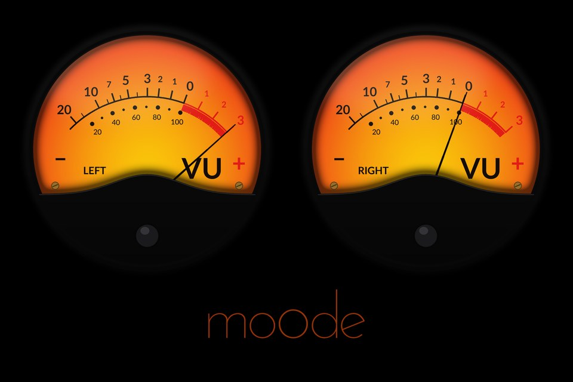

# moOde Peppy skins — 1920×1280

Peppy **Meter** and **Spectrum** skins scaled to **1920×1280** for any
[moOde audio player](https://github.com/moode-player/moode) install with a
1920×1280 local display (Raspberry Pi or x86), plus the small generators that
produce them.

The skins are **4× LANCZOS upscales** of moOde's stock **480×320** Peppy skins:
every image is resized ×4 and every pixel coordinate in `meters.txt` /
`spectrum.txt` is scaled ×4 to match, so the layout stays correct on a
1920×1280 panel.

## Contents

| File | What |
|---|---|
| `peppymeter-1920x1280.tar.gz` | Peppy **Meter** skin — extract into `/opt/peppymeter/` |
| `peppyspectrum-1920x1280.tar.gz` | Peppy **Spectrum** skin — extract into `/opt/peppyspectrum/` |
| `mkskin-1920x1280.py` | regenerate the Meter skin from `/opt/peppymeter/480x320` |
| `mkspec-1920x1280.py` | regenerate the Spectrum skin from `/opt/peppyspectrum/480x320` |

Each tarball contains a top-level `1920x1280/` folder.

## Install

```bash
git clone https://github.com/Gjuju/moode-peppy-skins.git
./moode-peppy-skins/install.sh
```

Manual install:

```bash
sudo tar xzf peppymeter-1920x1280.tar.gz    -C /opt/peppymeter/
sudo tar xzf peppyspectrum-1920x1280.tar.gz -C /opt/peppyspectrum/
```

Then in moOde, point the config at the new skin:
- `/etc/peppymeter/config.txt`: `meter.folder = 1920x1280`, `screen.width = 1920`, `screen.height = 1280`
- `/etc/peppyspectrum/config.txt`: `spectrum.folder = 1920x1280`

(Restart the local display afterwards.)

## Regenerate

Needs `python3-pil` and the stock `480x320` skins present under `/opt/peppy*/`.

```bash
python3 mkskin-1920x1280.py    # /opt/peppymeter/480x320   -> /opt/peppymeter/1920x1280
python3 mkspec-1920x1280.py    # /opt/peppyspectrum/480x320 -> /opt/peppyspectrum/1920x1280
```

The generators scale the pixel keys (`*.x`, `*.y`, bar/topping/reflection sizes,
etc.) by the same ×4 factor so the skin geometry matches the upscaled images.

## v5 moOde meters (1920×1280)

`peppymeter-v5-1920x1280.tar.gz` holds the 11 meters of moOde's
[v5-moode-meters](https://github.com/moode-player/plugins/tree/main/peppydisplay/v5-moode-meters)
plugin (`1280x720-moode` set: black-white, blue, champagne, emerald, gold,
orange, pure-white, red, rust, tube, white-red), scaled for a 1920×1280 panel.

- Backgrounds/foregrounds: ×4 ESRGAN (**4x-UltraSharp**) then LANCZOS down to
  **×1.5**; alpha scaled with LANCZOS. Needles/indicators: LANCZOS ×1.5.
- 16:9 → 3:2: the meter is centred vertically (`meter.y += 100`) and each
  `*-screen-bgr.png` is extended 100 px top/bottom by repeating its edge rows.
- `meters.txt`: `distance`, `*.origin.x/y`, `meter.x/y` scaled ×1.5.

Install:

```bash
sudo tar xzf peppymeter-v5-1920x1280.tar.gz -C /opt/peppymeter/
```

then `meter.folder = 1920x1280-moode` and `meter = <name>` in
`/etc/peppymeter/config.txt`, and restart the local display.

Regenerate (needs `torch` (CPU is fine, ~3.5 min/meter), `spandrel`, `pillow`,
`numpy`, the extracted plugin zip and the `4x-UltraSharp.pth` model):

```bash
python3 mkskin-v5-1920x1280.py <zip>/update/files/1280x720-moode 1920x1280-moode \
    --model 4x-UltraSharp.pth
```

## round-red (1920×1280)



`peppymeter-round-red-1920x1280.tar.gz` adds **round-red** to the
`1920x1280-moode` set: two round VU meters (black bezel melting into the black
screen, lower hill hiding the pivot) with the orange-to-yellow face of the v5
`red` meter. Drawn procedurally (no upscaling).

- Scale: −20…+3 VU over a voltage-linear arc, **0 VU = −3 dBFS** (+3 VU =
  digital full scale), with the 20…100 % row of a real VU meter.
- The marks are only true with **`volume.curve = 0`** (PeppyMeter's default)
  in `/etc/peppymeter/config.txt` (WebUI: Peppy config > meter curve). The curve
  is global, so it applies to every meter.
- The foreground holds only fully opaque/transparent pixels over the needle
  sweep: PeppyMeter re-blits `fgr` over areas whose `bgr` it did not restore,
  so a translucent foreground (glass, shadow) piles up into needle trails. Glass
  and inner shadow are baked into `bgr` instead.

Install: `install.sh` extracts it after the v5 set and (re)writes its section
in `/opt/peppymeter/1920x1280-moode/meters.txt`. Then `meter = round-red`
(`meter.folder = 1920x1280-moode`) and restart the local display.

Regenerate (needs `pillow` and the Lato font, `fonts-lato`):

```bash
python3 mkskin-round-red-1920x1280.py /opt/peppymeter/1920x1280-moode/red-screen-bgr.png out/1920x1280-moode \
    [curve] [0VU-dBFS]          # defaults: 0, -3
```
